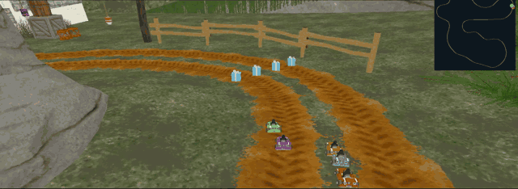
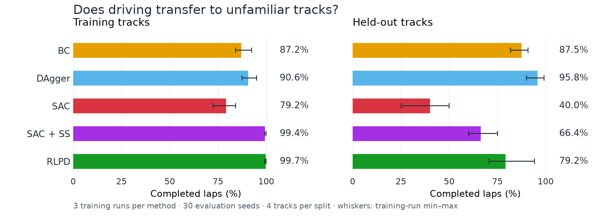

# Learning to drive: DAgger vs. RLPD

How should a driving agent learn from an expert: by asking for corrections as
it drives, or by combining demonstrations with its own experience?

This project compares behavior cloning (BC), DAgger, online SAC, SAC with
symmetric sampling (SAC + SS), and RLPD in solo SuperTuxKart driving. The
symmetric-sampling baseline separates the effect of mixing demonstrations and
online experience from RLPD's additional critic components.

## Five methods, one driving task




*Independent solo-lap replays on Lighthouse, a training track. Training seed 0;
evaluation seed 20000; excerpt from race seconds 5–13 at real-time speed.
This existing recording illustrates the viewer; it is separate from the
30-seed results below.*

## What transfers to new tracks?



RLPD has the highest mean completion on training tracks; DAgger has the highest
on the held-out report tracks. Mixing demonstrations into SAC improves completion,
but does not remove the transfer gap. The plot shows means and training-run
min–max across three independent runs per method, with 30 evaluation seeds on
each of four tracks per split.

See the [30-seed evaluation and full metrics](https://github.com/BshKatrin/tuxkart-dagger-rlpd/releases/tag/reevaluation-thirty-seeds-v1)
for lap times and driving diagnostics. [Figure provenance](docs/assets/readme/provenance.json)
records the plotted values and recording hashes.

## The study

Policies learn on four tracks and are evaluated on nine held-out tracks. All
methods share 84-value observations and five controls: steer, throttle, brake,
nitro, and fire. The expert is Team 4's original coordinator at a pinned source
commit, including recovery, hazard avoidance, item use, and nitro.

We measure completion alongside successful lap time, off-track time, and native
rescue counts. Separate disturbance experiments test recovery from matched
states; Monte Carlo continuations probe critic calibration. Independent training
runs are the statistical unit. Evaluation seeds describe variability within a
fixed controller.

The [study protocol](docs/study.md) defines the original comparison. The
[30-seed supplemental evaluation](docs/protocols/reevaluation-thirty-seeds.md)
extends evaluation to three completed training runs per method without replacing
the original results. Its eight-track report selection includes Zen Garden as
an additional held-out track.

## Try the policies

Use Python 3.12 and [uv](https://docs.astral.sh/uv/):

```sh
uv sync --locked
```

Download and restore the policy and data archives following
[experiment artifacts](docs/experiment-data.md), then open the native viewer:

```sh
uv run python -m kartstudy.playback
```

[Playback and recording](docs/visualization.md) covers controls and policy
selection. Simulation and evaluation inference use CPU. Training requires Apple
Metal (`mps`). The simulator downloads its assets on first use; rescue telemetry
also requires Xcode Command Line Tools to compile its read-only native bridge.

## Reproduce experiments

Qualify the expert before collecting demonstrations, then launch a fresh suite:

```sh
uv run python scripts/qualify_expert.py --output runs/qualification-polar-four/metrics.json
uv run python -m kartstudy.data --output data/team4-polar-four/demonstrations.npz
uv run python scripts/run_suite.py --output runs/study-polar-four --workers 2
```

These commands require unused dataset and suite destinations. Inspect results with:

```sh
uv run python scripts/status.py runs/study-polar-four
uv run python scripts/summarize.py runs/study-polar-four
```

Datasets, checkpoints, source snapshots, and evaluation logs live outside Git;
completed snapshots are available as [GitHub Releases](https://github.com/BshKatrin/tuxkart-dagger-rlpd/releases).
See [artifact restoration](docs/experiment-data.md) for compatible releases and
checksums. Use completed runs at matched budgets for final comparisons.

## Read further

- [Expert qualification and measurement limits](docs/expert-evaluation.md)
- [Track difficulty and policy names](docs/tracks-and-policies.md)
- [Road behavior and report analysis](docs/road-analysis.md)
- [Matched disturbances and critic diagnostics](docs/disturbance-study.md)

Built with [rl_mind](https://master-dac.isir.upmc.fr/rl/rl-mind/),
[PySTK2 Gymnasium](https://github.com/bpiwowar/pystk2-gymnasium), and
[Team 4](https://github.com/osigaud/pystk_project/tree/ddf2cb6573850f890bba26d4e5f82888d9dac82a/src/agents/team4).
